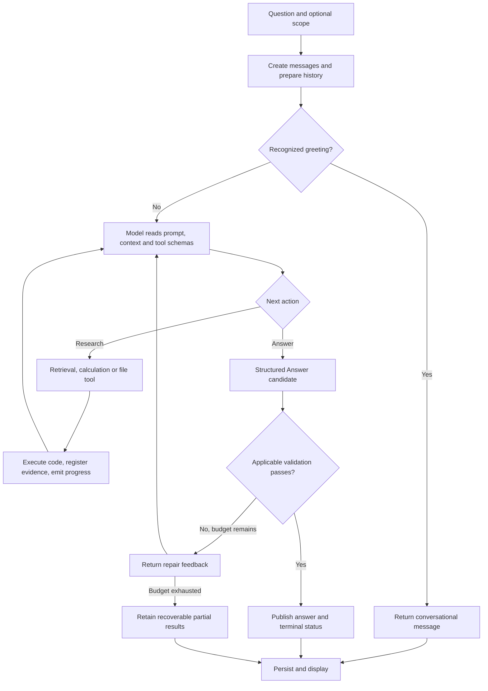

# Financial Research Agent: from a question to an answer and files

[README](../../README.en.md) · [中文详解](../zh-CN/processing-flow.md)

Checked on 2026-10-15 against source commit `6f981bf` in the original `fin-research-agent`. Subsequent documentation commits do not change that code baseline.

Developed by 周嘉翔 / zhoujiaxiang using gpt-6.1-sol. The development model is separate from the application's runtime model, selected through server-side `LLM_MODEL`.

## 1. The central idea

**The model chooses what to investigate and how to explain it. Code retrieves information, performs calculations, records evidence, checks output, saves files and serves the interface.**

Think of the model as a researcher and the tools as its library, calculator and filing cabinet. Saying “I found a source” does not create a registered citation. Saying “the report is ready” does not create a downloadable file.

The checks have limits: genuine sources and reproducible arithmetic do not automatically establish the right fiscal period, complete industry coverage or supported causal explanations.

## 2. Main flow

This diagram describes persisted chat with a configured model and autonomous research enabled. Tool order is model-selected rather than a fixed sequence.



File tools persist files when they succeed. A later answer failure does not automatically delete them. Existing files and a fully completed turn are distinct outcomes.

## 3. Responsibilities

| Component | Responsibility |
| --- | --- |
| React UI | Questions, progress, answers, source inspection and artifact previews |
| FastAPI | Request validation, session setup, task execution and event transport |
| ResearchAgent / Pydantic AI | Model configuration, tool registration, model turns and output retries |
| Research tools | SEC/web retrieval, text search, financial resolution and arithmetic |
| Validators | Citation registration, supported numeric checks, computation replay and applicable delivery gates |
| SQLite and workspace files | Source caches, citations, history, calculations and actual deliverables |

The Python service executes tools. The browser does not hold model credentials or call the model provider directly.

## 4. Important terms

| Term | Meaning |
| --- | --- |
| `thread_id` | A conversation containing messages and files, not a resumable background job |
| Message ID | One user or assistant message |
| Tool-call ID | One execution; repeated calls to the same tool get different IDs |
| `citation_id` | One registered text, numeric or derived evidence entry; not necessarily a whole filing |
| Claim | A cited answer paragraph, not a sentence-by-sentence semantic audit |
| Working file | Saved material that has not necessarily been published |
| Artifact | A registered deliverable with an actual file and download path |
| `caveats` | Limitation/methodology/reminder strings, without claim-level validation |

The original app does not use the Libre edition's durable independent `run_id`. Allowed evidence IDs, call counters and generated artifacts are primarily held in the current Agent dependencies; SQLite retains source and conversation records.

## 5. Receiving a question

The UI uses `POST /api/threads/{thread_id}/messages/stream`. It sends the question, scope and optional `replace_from` for edits. Persisted questions must have 2..4000 characters.

Scope contains output language, optional companies/years/forms, `strict`, and restatement policy. Open mode permits company and period discovery. Strict mode constrains tool expansion, although numeric form filtering is not fully unified with text scope.

The backend checks that the thread exists and is not already active. Concurrent messages in one thread return 409. It saves the user message, creates an empty `running` assistant message, updates the thread and marks it active in the current process.

Editing requires a user message from that thread. Messages from the edited point onward are deleted and regenerated; saved files remain. Their presence does not establish delivery by the new turn.

## 6. Preparing context

Context is bounded rather than a complete database dump:

- At most 20 history context entries, normally complete messages truncated to 8000 characters each.
- Historical citation hints from the latest 10 assistant event logs, capped at 300 IDs.
- Up to three tables with exactly matching scope; the autonomous path primarily exposes availability rather than preloading complete tables.
- The saved research sample and summaries of the latest 10 artifacts.
- Server date, strict scope and required language.

Historical text is not automatically current evidence. `inspect_evidence` reloads registered citations into the current allowed set before reuse.

Message `content` contains conversational text and claims. Caveats remain in full `answer_json` but are not automatically included as ordinary history text. Files must be inspected when their contents matter. Profile APIs do not currently provide automatic unlimited memory or training.

## 7. Prompt, intent and hard gates

Each model run reloads `prompts.toml`. System instructions describe research, sources, language, delivery and output policy; the user template inserts question/context. Tool schemas come from Python functions. Output is typed as `Answer`.

Changing the prompt changes behavioral instructions; it does not add execution capabilities or implement missing validators. Settings and their cache differ from per-run prompt loading.

In the default autonomous path, a small exact greeting set returns a predefined conversational message without entering the model loop. Other clarification/capability/non-research inputs mainly rely on prompt-directed conversational output; no comprehensive independent intent classifier exists.

| Requirement | Current enforcement |
| --- | --- |
| Broad analyses should deliver Markdown and XLSX | Prompt requirement |
| Explicit Excel/XLSX request marked complete without a workbook | Output gate |
| Explicit research-report pattern marked complete without a published report | Output gate |
| Every implicit analysis must pass both file gates | No unified hard gate |
| Every final download claim must match its file description semantically | No complete final semantic comparison |

Explicit report detection uses bounded keyword patterns. An implicit industry analysis may not trigger the same file gates or increased report token budget.

## 8. The research loop

The model reads the question and available tools, requests one or more calls, reads their results and decides what to do next. An industry analysis may discover companies, establish a sample, check periods, get facts, read drivers, compute ratios and publish files, but that order is not mandatory.

Results contain data, registered IDs, dates, pagination, warnings or errors. `update_plan` exposes a checklist; it is not a scheduler. Several plan updates do not mean several separate research jobs were created.

| Purpose | Tools |
| --- | --- |
| Companies/sample | resolve_companies, set_research_sample |
| Public sources | search_web, read_web |
| SEC directory/text | list_filings, list_filing_documents, search_filings, read_filing, read_filing_document |
| Financial facts/calculation | discover_financial_periods, get_financial_data, list_financial_concepts, compute_financial |
| Evidence reuse/progress | inspect_evidence, update_plan |
| Files/delivery | list_files, read_file, write_file, publish_artifact, publish_report, generate_workbook |

The original app also advertises execution capability and Python/shell tools, but the execution backend is unavailable and commands are always rejected. The bounded arithmetic tool is not arbitrary Python execution. File tools require a persisted thread.

## 9. Retrieving information

**Companies and industry leads.** Resolution searches local company records before SEC. Matching a name/ticker establishes identity, not sector membership. Web leads and registered sources support sample reasons, but no independent checker proves complete sector coverage.

**Filings and exhibits.** Submissions supply forms, dates, accessions and primary documents. Requested historical years determine historical directory shards; the app does not download all historical files unconditionally. HTML/TXT is converted into paragraphs with sections, positions, DOM paths, quotes and hashes. SQLite FTS5 uses keywords and BM25 rather than vector search. The model can retrieve adjacent context or declared exhibits. Exhibit filenames must come from the SEC directory, not guesses. PDF/OCR is unavailable.

Tables are often flattened into text, so a matching literal number does not establish the correct row, column or unit.

**Financial values.** Company Facts/XBRL stores amount, unit, concept, dates, fy/fp, form, accession and filing date. The resolver supports 22 mapped metrics:

```text
revenue net_income operating_income gross_profit cost_of_revenue
research_and_development selling_general_admin interest_expense income_tax
operating_cash_flow investing_cash_flow financing_cash_flow capital_expenditure
assets current_assets liabilities current_liabilities equity
accounts_receivable inventory accounts_payable cash
```

Discovering another issuer tag does not automatically make it comparable. Narrative numbers do not automatically become structured arithmetic inputs.

## 10. Fiscal periods

“2026” can mean a calendar year, issuer FY2026, filings published in 2026 or the latest available complete year. These differ.

Annual flows prefer complete periods of at least 300 days and actual end dates. Quarterly flows prefer standalone quarters, otherwise compatible cumulative differences; Q4 can be annual minus Q3 cumulative. Balance-sheet values use period-end instants. Concept, unit, dimensions and necessary date conditions must be compatible. `as_reported` chooses earlier disclosure; `latest_restated` chooses later restatement.

Company Facts fy/fp can describe the submitting context and contain prior comparisons. It is not a unified issuer fiscal-year identity. Discovery returns dates and warnings; end-year lookup does not claim to infer issuer FY. The model must check filing context.

An original-source lookup may pass for a value from the wrong target year. Numeric authenticity and target-period correctness are separate questions.

## 11. Provenance

A citation has an ID, SourceRef, Locator and optional ValueRef. SourceRef identifies company/document/URL/date; Locator identifies concept/dates, a quoted paragraph or formula inputs. ValueRef carries a Decimal amount and unit.

Tools store evidence in SQLite and add it to current `allowed_citation_ids`. Previously stored IDs not reloaded into this set cannot be used directly. Derived calculations create citations too; they are not new external documents.

UI source counts count entries, not filings. Numeric counts also include derived value citations, so they are not independent-original-fact counts. Source snapshots and hashes exist, but citations lack a complete immutable snapshot linkage.

## 12. Arithmetic and display

`compute_financial` takes an expression and variable-to-citation mappings. `cash/revenue*100`, with percent output, binds cash and revenue to current numeric citations. XBRL inputs are looked up again; derived inputs are replayed. The new result gets a derived citation and formula record.

Limits are 1000 characters, 80 AST nodes and 1..20 named inputs. Only constants, names, unary signs and four arithmetic operators are accepted. Every provided variable must be used; zero division fails. No calls, imports, files or host commands are supported. Unit compatibility is checked; percent/ratio/percentage-point inputs can participate dimensionlessly, but multiplying by 100 remains an explicit formula responsibility.

Calculation retains 34-digit Decimal precision. `display.text` rounds with ROUND_HALF_UP, removes negative zero and uses two places by default, with a 0..4 range. Examples: percent 7.67781155 becomes 7.68%; USD 751400000 becomes USD 751.40 million. Inputs for later calculations remain citation IDs, not rounded strings.

For currency formatting use `expression='x'`, USD output and original input. Do not divide the amount by a million and register the reduced result as the original USD value.

Deterministic tables have a separate Formula path supporting direct/subtract/divide/growth/cagr/share with source lookup and recomputation. Agent-derived chat ratios do not automatically populate workbooks.

## 13. Answer fields and yellow notices

| Field | Purpose |
| --- | --- |
| claims | Cited answer paragraphs |
| message | Greetings, clarification and ordinary conversation |
| caveats | Methodology, limitations and reminders |
| status | complete / incomplete / refused / error |
| status_reason | Completion/failure explanation |

Each Claim requires citations; numeric_bindings is optional. Conversational message cannot coexist with research claims, and explicit financial amounts/percentages are restricted, but no full semantic conversation classifier exists.

In normal research the model chooses caveat strings; fallback/error code may also add fixed notices. The UI renders them in order using the yellow `.notice` style. Color alone does not encode completion.

**Caveats receive string-array validation, not claim-level citation, numeric or causal checks.** Report caveats are likewise inserted into a methodology/limitations section. A material assertion about debt-exchange losses placed only there is not claim-validated. Substantive financial findings should belong in cited claims, but this separation is not comprehensively enforced. Report and final-answer caveats also need not be identical.

## 14. Publication checks

The normal path checks typed output, current citation membership/existence, recursive derived replay, exact binding spans and cited IDs, applicable amounts/scales/rounding/signs, supported paragraph digits and bounded exclusions, at most four decimal places, and applicable explicit file gates.

Loss/outflow presentations have special negative-source and local-wording checks. Money parsing handles supported language/unit scales, but does not independently reconstruct all table row/column semantics. Validation collects the first encountered error from each paragraph so a retry can repair several paragraphs; it does not exhaust every possible defect at once.

Passing does not establish every sentence's support, cross-company comparability, correct financial methods, universal numeric bindings, sector completeness, causality or caveat truth. Replay uses the same engine, not an independent second financial-method auditor.

## 15. Repair and budgets

Pydantic AI can send `ModelRetry` feedback for output errors. The model may repair IDs, spans, signs, dates, retrieve more evidence, publish missing files or remove unsupported findings. Output retries default to two.

Research tools block identical failing calls after two failures; selected web 403/404 outcomes are remembered to avoid repeating inaccessible URLs. Tool errors may be returned as records or trigger parameter repair. There is no universal network retry strategy. Output retries, tool calls and resource failures have different counters.

## 16. Real report and workbook delivery

`write_file` creates unpublished text material. `get_financial_data` can create JSON work files. `publish_artifact` publishes a text copy marked not financially verified. `publish_report` checks cited sections and writes Markdown containing title, sections, numbered references, caveats and a source locator index. Artifact metadata includes an actual file, byte count, SHA-256 and originating-message information.

Report checking is citation-rule checking, not full semantic audit. It does not separately validate caveats.

`generate_workbook` builds supported metrics from deterministic data, not freely transcribed model numbers. A period needs revenue availability for at least one company; all companies/metrics need not be complete. Export requires at least one verified cell and every other cell verified or missing, with mismatches blocking export. Missing is not zero.

Annual sheets are Data/Provenance. Quarterly sheets separate statements, data/calculation scope, Provenance and notes. Narrative-only values and all Agent-derived ratios are not automatically included; report/workbook coverage may differ.

Downloads read actual bytes and compare the registered hash; tables are revalidated against stored sources. Missing/changed files or invalid tables are rejected. Hash equality establishes version identity, not financial truth. Files already produced survive later answer failure.

## 17. Streaming and UI behavior

SSE transports named JSON events rather than every model token:

| Event | Meaning |
| --- | --- |
| message.created | Message identities established |
| status | Execution progress, warnings or repair |
| sources | Registered evidence |
| plan / sample | Checklist or research sample |
| artifact | Generated deliverable |
| answer.snapshot | Published answer structure, possibly incomplete during recovery |
| error | Execution error |
| done | Terminal transport status |

Tool/status progress is live. The normal path drains model output without publishing incomplete JSON or provisional prose, then publishes after whole-answer validation. Status movement with no answer yet is therefore expected. Hidden reasoning is not exposed.

A recovered partial snapshot is not complete success. Browser transport requires `done`; a closed connection without it produces an interruption message. Heartbeats keep transport active without implying new findings.

## 18. Failure, cancellation and partial recovery

`CommittedAnswer` extracts closed, parseable, paragraph-checked claims from public output candidates. It resets for a new candidate instead of accumulating old retry versions.

Exceptions may retain current recoverable claims. With no recoverable claims but numeric evidence, the app may produce up to six explicitly labelled retrieved-data excerpts. These recovery paths are not identical to normal whole-answer publication; excerpt values may use raw formatting.

Complete means the current path considers its applicable gates passed. Incomplete means partial/interrupted delivery; refused covers selected evidence/validation failures; error denotes execution failure. Interpret status with reason, events and retained material rather than the last successful tool.

Stopping uses AbortSignal; backend producer tasks and streams are cancelled/closed, records are saved on exit and existing files remain. No final answer may leave an empty/incomplete assistant message. There is no continued durable background research, automatic checkpoint resume or SSE replay.

## 19. Persistence

SQLite stores companies/filings/facts/chunks/search indices, citations/cache/snapshots/computations, messages/full Answer JSON/scope/events/status, and Artifact metadata. Actual files live in session directories, normally beside `.data/finagent.sqlite3` under `.data/workspaces/<thread_id>/`.

Message events principally retain statuses, citation IDs, errors, plans and samples; sources and files have separate records. Restart reloads records, not model execution stacks. A stored running message with no current active task is shown incomplete. Thread deletion removes database thread records but keeps disk files as archives. Backups need a consistent SQLite snapshot and the workspace files.

## 20. Operational limits

Defaults: 60 total tools, model-request limit tool budget + 5, 600 seconds per research turn, 4000 normal output tokens, at least the configured 8000 report tokens for detected explicit report requests, and two output retries. Implicit analysis may not trigger the increased budget.

File limits default to 10 MiB/file, 100 MiB/thread, 200 files and 256 KiB text operations. These are configurable application limits, not OS hard quotas.

Cache lifetimes vary: common defaults include a day for documents/directory indices, an hour for submissions and six hours for Company Facts. Selected errors can fall back to cached data with warnings. Cache hits do not establish current upstream availability or complete latest disclosure coverage. SEC's default five requests/second is per client, not a complete global limiter across concurrent Agents.

Files use flat session-local names, disallow paths/hidden files/overwrite/symlink traversal and default to file mode 0600/directories 0700. Public web retrieval checks HTTPS/DNS/IP/redirects and rejects private addresses. These are local defenses, not a production sandbox. The original app has no user authentication, tenant isolation or authorized downloads; IDs are not permissions. Single-user trusted-network, single-process deployment is the current boundary.

## 21. Compatibility paths

The autonomous stream requires `AGENTIC_RESEARCH=true`, a configured model name and key. Otherwise the compatibility path ingests the selected scope, performs fixed retrieval/table preparation and generates an explanation or extractive fallback. This is not autonomous deep research without a model, and it can prepare data before ordinary answer handling.

Synchronous `/api/ask`, non-persisted `/api/ask/stream`, direct tables and direct XLSX endpoints remain. A request without a persisted thread does not have the same session-file tools and Artifact lifecycle.

## 22. Illustrative turn

For “Analyze a company's latest three complete years and cash quality”: create the turn; resolve the company; verify actual fiscal dates; fetch supported revenue/profit/cash/capex values; read operating drivers and unusual items; compute requested ratios; publish the report and workbook; submit Answer; repair any applicable validation errors; then publish a terminal result or retain explicitly incomplete material.

For illustration only, cash 20 divided by same-currency revenue 100 times 100 gives 20.00%. This is not a real company's sourced financial claim. Actual tool order can vary, and one successful stage does not establish the rest.

## 23. Current design gaps

The most material gaps are deterministic target-FY validation, claim-level caveat checking, unified delivery intent gates, sentence-level semantic review, structured narrative tables, report/workbook coverage matching, fully equivalent failure recovery validation, and durable task resumption. This document describes these gaps; it does not implement changes to research or validation.

## 24. Evaluation is a separate flow

The runner acts as an HTTP user, retains questions/document targets/events/answers/sources and keeps gold evaluator-side. Preparation pins a FinanceBench blob, checks SHA-256 and selects ten rows with seed 42. Metadata records model, budgets, source/prompt hashes, concurrency and timeout.

The runner records traces, not comprehensive automatic semantic scores. Review must assess completion, target period, numbers, support and applicable delivery. Unit tests, compilation and lint address different questions from model accuracy. The historical 9/10 development result predates later publication, file and display changes; it is not a latest-code accuracy guarantee. No tests or new model evaluations were run for this documentation task.

## 25. Code map

| Area | Code | Companion guide |
| --- | --- | --- |
| UI/events | [main.tsx](../../frontend/src/main.tsx), [api.ts](../../frontend/src/api.ts) | [Frontend](frontend.md) |
| Sessions/files/downloads | [workspace.py](../../src/finagent/workspace.py) | [Sessions/artifacts](sessions-artifacts.md) |
| Dispatch/SSE/timeouts | [api.py](../../src/finagent/api.py) | [API](api.md) |
| Model loop/gates | [agent.py](../../src/finagent/agent.py) | [Agent/tools](agent-tools.md) |
| Research actions | [research_tools.py](../../src/finagent/research_tools.py) | [Sources/retrieval](sources-retrieval.md) |
| Instructions/types | [prompts.toml](../../src/finagent/prompts.toml), [schemas.py](../../src/finagent/schemas.py) | [Agent/tools](agent-tools.md) |
| Periods/calculation | [facts.py](../../src/finagent/data/facts.py), [compute](../../src/finagent/compute/) | [Financial computation](financial-computation.md) |
| Validation | [citations.py](../../src/finagent/verify/citations.py), [numbers.py](../../src/finagent/verify/numbers.py) | [Provenance](provenance-validation.md) |
| Recovery | [answer_stream.py](../../src/finagent/answer_stream.py) | Section 18 |
| Deliverables | [tools.py](../../src/finagent/tools.py), [filesystem.py](../../src/finagent/filesystem.py) | [Sessions/artifacts](sessions-artifacts.md) |
| Settings/storage | [config.py](../../src/finagent/config.py), [storage.py](../../src/finagent/storage.py) | [Operations](operations.md) |
| Evaluation | [eval/runners](../../eval/runners/) | [Testing/limits](testing-capabilities.md) |

The model selects research actions; tools preserve evidence and calculations; code applies bounded publication rules. Completion is not comprehensive correctness certification. Conversations and files persist, but interrupted model tasks do not automatically resume.
