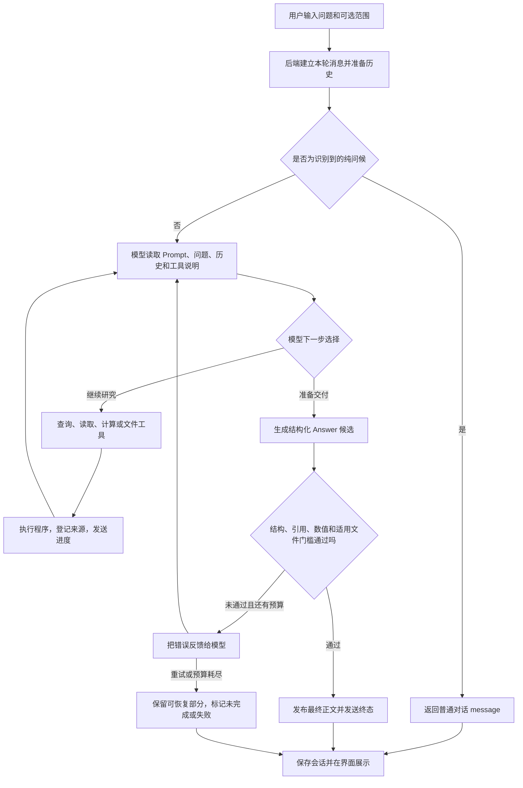

# 财报研究助手：一次提问是怎样变成回答和文件的

[README](../../README.md) · [English](../en/processing-flow.md)

核对日期：2026-10-15。本文说明 `fin-research-agent` 原版当前处理流程，按源代码提交 `6f981bf` 核对。后续文档提交不改变这一代码基线。

项目由周嘉翔 / zhoujiaxiang 使用 gpt-6.1-sol 开发。开发时使用的模型与产品运行时调用的模型是两个概念：运行模型由服务端 `LLM_MODEL` 配置决定。

阅读建议：先读第 1–4 节建立整体概念，再读第 22 节的例子。想解释底部黄字看第 13 节；想解释正文迟迟不出现看第 17 节；想了解失败和停止看第 18 节。其余章节按需深入。

## 1. 先用一句话理解整个系统

**模型负责决定查什么、怎么算、怎么解释；程序负责执行查询和计算、保存来源、检查输出，并把结果交给界面。**

可以把模型理解成研究员，把工具理解成研究员能使用的资料室、计算器和文件柜。模型不能仅凭一句“我查到了”就让系统产生真实来源，也不能仅凭一句“报告已生成”就得到下载文件。

不过，当前检查仍有覆盖范围：有来源、有正确算式，并不自动证明财年选对了、行业样本完整了，或整段商业判断都成立。

## 2. 完整流程总览

下面展示配置了模型、开启自主研究、通过聊天界面发起请求时的主流程。工具调用顺序由模型决定，不是每次都把这些步骤机械地走一遍。



文件工具在执行成功时就保存实际文件。最终回答后来失败，不会自动删除此前成功生成的文件；“已有文件”和“本轮完整完成”是两件事。

## 3. 各部分分别做什么

| 部分 | 通俗解释 | 主要职责 |
| --- | --- | --- |
| React 界面 | 用户的工作台 | 提问、显示进度、查看回答、点击来源和文件 |
| FastAPI 接口 | 接待和传递消息的人 | 校验请求格式、建立会话、启动任务、发送事件 |
| ResearchAgent / Pydantic AI | 研究员的工作组织器 | 配置模型、注册工具、管理模型往返和输出重试 |
| 研究工具 | 资料室和计算器 | 获取 SEC/网页数据、检索原文、解析财务值、执行算式 |
| 校验代码 | 核对员 | 检查引用登记、部分数值支持、公式重放和文件条件 |
| SQLite 与会话目录 | 资料柜和文件柜 | 保存缓存、来源、历史、计算记录和真实交付文件 |

模型服务在外部配置的端点运行。Python 服务执行研究工具；前端不保存模型密钥，也不直接调用模型提供商。

## 4. 先分清几个容易混淆的概念

| 名称 | 是什么 | 不是什么 |
| --- | --- | --- |
| 会话 `thread_id` | 一组连续问题、回答和文件的容器 | 能跨重启自动继续运行的后台任务 |
| 消息 ID | 当前用户消息或助手消息的标识 | 来源编号 |
| 工具调用 ID | 一次具体工具执行的标识 | 同名工具所有调用的共同编号 |
| 引用 `citation_id` | 一条登记的原文、数值或派生计算证据 | 仅仅一个网址，也不一定对应一整篇财报 |
| `Claim` | 正文里的一个带引用段落 | 每一句都已经经过语义审计的结论 |
| 工作文件 | 已写入会话目录、尚未发布的材料 | 自动可下载的交付物 |
| `Artifact` | 已登记、具有真实文件和下载路径的交付物 | 聊天里普通的一段文字 |
| `caveats` | 回答的口径、局限或提醒字符串 | 已按正文规则逐条核验的事实 |

原版没有 Libre 二开版的独立持久化 `run_id` 机制。本轮允许使用的引用、工具计数和已生成文件集合主要放在当前 Agent 的运行依赖中；数据库保存来源和会话记录。

## 5. 用户提交问题后，后端先做什么

### 5.1 界面发出请求

界面默认使用持久化聊天入口：

`POST /api/threads/{thread_id}/messages/stream`

请求主要包括问题、研究范围 `scope`，以及编辑旧问题时的 `replace_from`。问题长度要求为 2..4000 字符。

研究范围包括：

- 输出语言：中文或英文。
- 可选公司、年份和表单，例如 10-K、10-Q。
- 是否启用 `strict`，即限制模型扩展研究范围。
- 重述口径：采用最早披露还是最新重述值。

不选公司和年份也可以研究。开放模式下，模型应自己找公司和期间；严格模式要求工具遵守已给定范围。但数值事实的表单过滤并未与所有文本工具完全统一，不能把 strict 理解成所有口径问题都已解决。

### 5.2 建立本轮记录

后端先确认会话存在，检查它是否正在生成。同一个会话同时发送另一条问题会返回 409。

然后在数据库里：

1. 保存用户消息。
2. 建立一个暂时为空、状态为 `running` 的助手消息。
3. 更新会话的范围、时间和必要的标题。
4. 把当前会话放入进程内的“正在运行”集合。

这使刷新后可以找回会话记录，但不意味着模型执行过程本身已经变成可恢复的持久化任务。

### 5.3 编辑问题的处理

`replace_from` 必须指向本会话中的用户消息。后端删除该消息及之后的消息，再从修改后的问题重新研究。

已保存的文件不会因此一起删除。所以重新生成后仍看到旧文件，不代表新一轮已经重新完成了这些文件。

## 6. 历史记录怎样进入下一轮

系统没有把整个数据库或所有历史全文塞给模型，而是准备有界上下文：

- 最近最多 20 条历史上下文条目；正常历史只使用 `complete` 消息，每条最多 8000 字符。
- 最近 10 条助手消息事件中的历史来源 ID 提示，最多 300 个。
- 最多 3 个与当前 scope 完全匹配的历史表格上下文；默认自主路径主要提示其存在，不自动注入完整数据。
- 会话保存的研究样本，以及最近 10 个交付文件的摘要和下载路径。
- 当前服务器日期、严格范围和输出语言。

历史回答只是上下文，不直接变成本轮证据。模型复用旧引用时，必须调用 `inspect_evidence`，将数据库中的引用重新载入本轮允许集合。

另外，历史消息的 `content` 主要保存 `message` 和 `claims` 正文；黄字 `caveats` 保留在完整 `answer_json` 中，不会作为普通历史正文自动全部带入下一轮。需要相关文件内容时，模型仍应读取文件。

目前没有无限记忆、自动训练，也没有自动把 profile API 中的偏好完整注入研究过程。

## 7. 模型是怎样接到任务的

### 7.1 Prompt、工具说明和问题是不同的输入

每次建立模型请求时，系统重新读取 `prompts.toml`：

- System Prompt：规定研究原则、来源要求、语言、文件交付和回答格式。
- 用户模板：放入当前问题、范围和已有上下文。
- 工具 schema：由 Python 函数签名和说明生成，告诉模型每个工具能做什么、接受哪些参数。

模型输出要求是 `Answer`，而不是任意字符串。Pydantic AI 负责让输出符合该结构，并在适用时把错误反馈给模型。

改 Prompt 可以改变研究行为要求；不能凭此增加工具、开通 Python 执行或消除程序中的校验缺口。模型配置和预算来自服务端配置，配置缓存与 Prompt 的逐请求重读不是同一机制。

### 7.2 问候和研究分开处理

在默认自主研究路径中，完全匹配“你好”“hello”等有限问候集合的问题，直接返回预设 `message`，不进入研究模型循环。

能力咨询、澄清或其他非研究输入主要由 Prompt 引导模型使用普通对话字段。当前没有覆盖所有自然语言输入的独立意图分类器。

### 7.3 哪些要求是“告诉模型”，哪些是“程序强制”

这一区别非常重要：

| 事项 | 当前实现 |
| --- | --- |
| 综合公司/行业/业绩分析默认交付报告和 XLSX | Prompt 明确要求 |
| 显式 Excel/XLSX 请求未生成工作簿却报完成 | 有对应输出校验 |
| 命中显式研报请求规则，却未发布报告而报完成 | 有对应输出校验 |
| 任意隐含分析请求都强制同时交付两种文件 | 当前没有统一硬门槛 |
| 所有下载链接都自动和正文描述逐条核对 | 当前没有全面的最终语义核对 |

不能把 Prompt 中的要求直接当成后端已经无条件强制实现的规则。原版显式研报识别仍基于有限的关键词模式；普通行业分析不一定触发同样的输出预算或文件硬门槛。

## 8. 自主研究循环：没有固定的查询顺序

模型通常会先理解问题，再选择工具。例如行业分析可能需要找行业定义、发现公司、确定样本、核实期间、获取财务数据、查看驱动因素、做计算，再组织报告。

但程序没有一个固定流程要求“每次先查 A 再查 B”。一次模型往返中，模型可能提出一个或多个工具调用；工具执行后把结果返回，模型再决定下一步。

工具结果通常包含数据、引用 ID、实际期间、下一页位置、警告或错误。模型应据此调整计划，而不是根据自己的记忆伪造结果。

`update_plan` 是对外展示的工作清单，不是任务调度器。界面显示多次“更新研究计划”，表示模型多次修改或确认清单，不代表后端额外启动了多个研究项目。

### 工具按用途可以分为六组

| 目的 | 工具 | 关键边界 |
| --- | --- | --- |
| 确认公司和研究样本 | `resolve_companies`、`set_research_sample` | 名称匹配不证明行业归属，样本不是全行业 |
| 寻找和读取公开资料 | `search_web`、`read_web` | 搜索摘要只是线索，读取后才登记网页证据 |
| 寻找和阅读 SEC 文件 | `list_filings`、`list_filing_documents`、`search_filings`、`read_filing`、`read_filing_document` | 目录不等于正文，附件必须来自 SEC 声明目录 |
| 获取财务值和计算 | `discover_financial_periods`、`get_financial_data`、`list_financial_concepts`、`compute_financial` | 指标覆盖有限，实际日期仍需核对 |
| 复用来源和展示计划 | `inspect_evidence`、`update_plan` | 历史引用须重新载入，计划不是完成证明 |
| 创建工作材料和交付文件 | `list_files`、`read_file`、`write_file`、`publish_artifact`、`publish_report`、`generate_workbook` | 创建、发布、财务核验是不同步骤 |

原版还暴露执行能力查询和 Python/shell 工具，但执行后端不可用，代码和命令始终被拒绝。`compute_financial` 是受限算式计算器，不是任意 Python 执行。

## 9. 三类资料是怎样取得的

### 9.1 公司和行业线索

公司解析优先查询本地公司目录，找不到再查询 SEC。结果是 ticker、CIK、公司名等主体信息。

行业问题可以先通过公开网页寻找公司和产业链线索。登记研究样本时需要支持理由的引用；即使这些引用都存在，也没有独立机制证明样本已经覆盖整个行业。

### 9.2 财报原文与附件

SEC submissions 提供申报目录：表单、日期、申报编号 accession、主文件等。要求历史年份时，工具会按需要访问历史目录分片，不会无条件下载所有历史文件。

阅读正文时，程序获取 HTML/TXT、清理并切成段落，再保存章节、段落位置、DOM 路径、摘录及哈希。检索使用 SQLite FTS5 的关键词与 BM25 排序，不是向量语义检索。

搜索命中后，模型可以继续读取相邻段落或指定附件。附件必须先由 SEC 文件目录发现，不能让模型随意猜文件名。当前没有 PDF/OCR 阅读能力。

表格往往被压成文本段落，行、列、币种单位的结构可能丢失。因此“摘录里出现了这个数字”不一定证明它属于正确列或正确指标。

### 9.3 结构化财务数据

Company Facts 提供 XBRL 数值。程序保存数值、单位、concept、期间起止、fy/fp、表单、申报编号和披露日期，再由财务解析器选取可比数据。

当前固定映射 22 个指标：

```text
revenue net_income operating_income gross_profit cost_of_revenue
research_and_development selling_general_admin interest_expense income_tax
operating_cash_flow investing_cash_flow financing_cash_flow capital_expenditure
assets current_assets liabilities current_liabilities equity
accounts_receivable inventory accounts_payable cash
```

可以浏览其他标签，但发现一个公司自定义标签，不会自动把它变成可比较指标。模型不能把原文中的任意数字直接升级为 `compute_financial` 的结构化输入。

## 10. 财年和季度为什么需要单独解释

用户说“2026 年”，可能指自然年、发行人 FY2026、2026 年披露的财报，或截至当时最近的完整财年。这些含义不同。

当前解析器大致这样选择：

- 年度流量指标优先完整年度数据，持续期至少 300 天，结合最新实际结束日选择。
- 季度流量优先独立季度；没有时用兼容的累计值相减。
- Q4 可由全年减去前三季度累计得到。
- 资产负债表余额取期末值，Q4 通常对应 FY 期末。
- 数据必须在概念、单位、维度和必要的期间条件上兼容。
- `as_reported` 选目标期间较早披露版本；`latest_restated` 选较晚重述版本。

关键缺口是：Company Facts 的 fy/fp 可能描述申报上下文，里面包含此前年度的比较数据，不必然等于该数值所属的发行人财年。

`discover_financial_periods` 会提供实际 start/end 和警告；按结束年份寻找收入观察值时，也不声称已推导正确的发行人 FY。模型仍需结合财报原文确认口径。

**因此，一个数值通过来源回查，也可能来自用户不想要的年度。来源正确与目标期间正确需要分别判断。**

## 11. Provenance：怎样留下“这句话从哪里来”

Provenance 可以理解成结果的来历。每条引用通常包含四部分：

| 部分 | 保存的内容 | 用途 |
| --- | --- | --- |
| 引用 ID | 数据库中的稳定标识 | 让正文和计算明确指向证据 |
| `SourceRef` | 公司、文件类型、申报编号、日期、URL、可选文件哈希 | 确认来自哪家公司、哪份资料 |
| `Locator` | XBRL 概念/单位/日期，或原文段落/摘录，或公式及输入 ID | 定位到资料内部的具体位置 |
| 可选 `ValueRef` | Decimal 数值和单位 | 用于数值绑定与计算 |

工具取得可用证据后会登记进 SQLite，同时加入当前运行的 `allowed_citation_ids` 和证据集合。只有数据库里存在但本轮没载入的旧 ID，不能直接用于本轮结论或计算。

派生计算也会形成引用，保存表达式、输入 ID 和计算记录；它不代表又找到了一个外部原文来源。

界面的“来源数”统计引用条目，不是财报篇数。数值来源计数包含具有数值的派生引用；不能把“54 条财务数据”简单理解成 54 个互相独立的原始事实。

缓存还保存来源正文哈希和快照，但引用与不可变快照之间没有完整的强绑定关系，不能宣称已实现全套不可变审计链。

## 12. 财务计算和数字展示怎样分开

### 12.1 计算不接受模型随手抄的数字

`compute_financial` 接受表达式和变量到引用 ID 的映射。例如：

```text
expression = cash / revenue * 100
inputs = cash 对应本轮经营现金流引用，revenue 对应本轮收入引用
output_unit = percent
decimal_places = 2
```

程序检查输入是否属于本轮、是否有数值，原始 XBRL 输入是否能回查一致，派生输入是否能重放。它再执行受限算式，保存新的派生引用。

表达式最多 1000 字符、80 个 AST 节点、1..20 个输入，只支持数字常数、变量、单目符号和四则运算。禁止函数调用、导入、文件访问或宿主机命令。所有提供的变量必须实际使用；零分母报错。

加减要求单位兼容，乘除也检查量纲。百分率、ratio、百分点可作为无量纲数参与计算，但工具不会自动把 0.2 和 20% 之间的数字语义换算好；正确的乘 100 仍需由公式表达。

### 12.2 算得精确与展示得易读是两件事

计算采用 34 位 Decimal 有效精度，记录保留完整结果。展示用 `display.text`，默认两位小数、允许 0..4 位，采用 ROUND_HALF_UP 并去掉负零。

例如：

| 原始值 | 展示 |
| --- | --- |
| percent 数值 7.67781155 | 7.68% |
| USD 751400000 | USD 751.40 million |
| USD 1500000000 | USD 1.50 billion |

绑定四舍五入后的文本时，仍指向原始引用。下一步计算也继续使用引用 ID，不能使用“7.68%”这样的展示字符串代替精确输入。

仅缩放已有货币值时，用 `expression='x'`、`output_unit='USD'`；不能先把实际金额除以一百万，再把缩小后的数值登记成原始 USD 金额。

另外，确定性表格有自己的 Formula 和回查机制，支持 direct/subtract/divide/growth/cagr/share。它与 Agent 的表达式计算是两条相关但不同的路径。聊天中的派生计算不会因此自动全部进入 XLSX。

## 13. 模型最终提交的结构是什么

正常输出是 `Answer`，主要字段如下：

| 字段 | 作用 | 主要检查 |
| --- | --- | --- |
| `claims` | 正文中的带来源段落 | 引用、数值和派生重放等规则 |
| `message` | 问候、能力说明、澄清等普通对话 | 不能与研究 claims 混用，显式金融金额和百分率受限制 |
| `caveats` | 口径、局限和提醒 | 字符串数组结构，没有逐条正文级核验 |
| `status` | complete / incomplete / refused / error | 与当前适用规则及异常路径有关 |
| `status_reason` | 未完成或失败原因 | 用于解释状态，不是研究结论 |

每个 `Claim` 至少有一个引用 ID。`numeric_bindings` 把某段具体数字文本绑定到一条引用，但它目前不是所有数字都必须提供的必填字段。

### 为什么底部会出现黄字

正常研究时，模型根据 Prompt 和工具结果自行填写 `caveats`；例如提醒财年不等于自然年、资料不完整或样本有限。异常/降级时，后端也可能写入固定提醒。

UI 把这些字符串按顺序用 `.notice` 黄色样式显示，没有独立的“生成黄字算法”，也没有根据黄色判断成功或失败。

当前 `caveats` 不执行正文级的引用、数字和因果核验，发布报告时也只是把报告 caveats 放入“限制与口径”部分。因此，“债务置换损失扭曲净亏损”这类实质财务判断如果仅放在黄字里，不能视为已经通过正文规则检查。更合理的内容归属是带引用的正文；这项约束目前尚未全面强制实现。

最终回答与报告各自有 caveats，没有机制保证两处逐字一致。

## 14. 正文发布前具体检查什么

当前检查可以理解为几道关口：

1. **结构**：模型输出能解析成 `Answer` / `Claim`，不是破碎 JSON 或普通问候文本冒充研究结果。
2. **引用登记**：引用 ID 属于本轮允许集合，并在 SQLite 中存在；错别字 ID 不自动替换，只提供可能的候选。
3. **派生重放**：派生引用的输入及记录存在，递归回查后重算结果一致。
4. **数字绑定**：绑定文本确实出现在当前段落，它的引用属于当前段落，金额、缩放、舍入和必要的符号条件匹配。
5. **段落数字支持**：对适用的货币、百分率、天数及其他实质数字检查数值或原文字面支持；日期等有限类别作排除。
6. **展示精度**：实质数字超过四位小数会拒绝，要求使用易读展示并同步修改绑定文本。
7. **适用文件要求**：显式 Excel/研报请求满足相应的当前轮次文件门槛，不能仅复用以前的文件集合报完成。

流出/亏损的正数幅度与负数来源有专门 presentation 规则；附近措辞会影响判断。金额单位支持中英文和 million/billion 等缩放，但不能据此保证任意表格中的行列、指标和符号语义都已正确识别。

不同段落的错误会汇总反馈，模型可以一次修正多个段落。每个段落通常只反馈当前首先遇到的错误，不是一次穷尽所有可能问题。

### 通过检查之后，仍有哪些事情没被证明

- 某条引用支持了整段中的每一句商业判断。
- 两家公司采用相同财年、币种、会计口径和可比业务。
- 模型选用的财务公式在该行业一定正确。
- 所有数字都已经建立强制、逐一的绑定。
- 整个行业样本已完整，或因果关系已经独立验证。
- caveats 中的事实已核验。

计算重放使用同一套引擎，不是另一个独立审计实现。正确重算一个错误选定的公式，仍可能得到不合适的金融结论。

## 15. 校验失败后会发生什么

结构化输出或引用检查失败时，Pydantic AI 可以把错误作为 `ModelRetry` 反馈给模型。模型随后可能：

- 改引用 ID 或展示绑定。
- 修改金额符号、单位或期间说明。
- 调用计算/读取工具补充证据。
- 发布遗漏的报告或工作簿。
- 删除无法支持的结论，返回未完成。

默认输出重试预算是 2，不是无限自我修正。

研究工具还对重复失败做限制：相同失败调用达到两次后会被阻止；部分网页 403/404 会在本轮记录，避免反复请求不可访问网址。工具失败可能返回错误记录，也可能通过 ModelRetry 让模型修正参数；没有覆盖所有网络故障的统一自动重试策略。

校验重试次数、工具调用次数和网页读取失败次数是不同计数，不能把它们混成“模型最多只能试两次任何事情”。

## 16. 报告与 XLSX 是怎样真正保存的

### 16.1 工作材料和发布文件分开

- `write_file`：创建 .md/.txt/.csv/.json 工作材料，不自动发布。
- `publish_artifact`：复制并发布已有文本，标记为模型生成、未财务核验。
- `publish_report`：检查报告各段的引用规则，通过后生成 Markdown、来源索引和定位信息，保存真实文件。
- `generate_workbook`：从确定性财务表及其来源生成核验 XLSX，不直接采用模型自由抄写的数字。

`get_financial_data` 在会话中也会保存 JSON 工作文件，但这不自动成为用户看到的交付文件。

### 16.2 报告如何形成

模型提交标题、若干带引用的 sections 和 caveats。程序检查 sections，再生成：

1. 报告标题。
2. 正文段落与编号来源链接。
3. “限制与口径”部分。
4. 来源列表，包含引用 ID、原 URL 和具体定位。

文件保存到会话目录，数据库登记 Artifact、文件名、大小、SHA-256 和创建本文件的消息信息。工具返回真实 Artifact ID 和下载路径。

这是引用规则检查过的报告，不是已经完成全文语义审计的研报。下载时也不重新完整审计报告正文。

### 16.3 工作簿如何形成

工作簿工具按指定公司和年份生成年度或季度期间。一个期间至少有某家公司可解析收入时，才进入候选导出期间；收入存在不保证所有公司、所有指标都有数据。

程序构建支持的财务指标表，回查每个数值来源并复算支持的 Formula：

- 至少一个格子通过核验。
- 其余格子必须通过或明确缺失。
- 不允许出现 mismatch 而继续导出。

缺失保留为缺失，不补成零。所以工作簿 `verified=true` 不等于每个单元格都有数据。

年度工作簿包含 Data、Provenance。季度工作簿另分损益、现金流、资产负债表、数据与计算口径、Provenance 和说明。

它不会自动收集报告里所有原文数字或所有 `compute_financial` 的派生比率。报告与 XLSX 可能有覆盖差异，需要说明，不应声称工作簿包含所有分析数据。

### 16.4 下载时再检查什么

下载接口先找到 Artifact，读取真实文件并核对登记哈希。表格文件还会重新核验数据库中的表格来源数据。

文件丢失、内容变更或表格检查失败会拒绝下载。哈希一致只证明文件版本一致，不证明报告中的全部财务解释正确。

## 17. 为什么工具在动，正文却还没出现

SSE 是服务器不断向浏览器发送事件的一种连接方式。本项目发送的是有名称、有 JSON 数据的事件，不是把模型所有文字逐字原样透传。

| 事件 | 含义 | 界面通常显示什么 |
| --- | --- | --- |
| `message.created` | 本轮用户/助手消息已建立 | 对应消息容器 |
| `status` | 开始、完成、工具警告或校验修正 | 工具进度卡片 |
| `sources` | 工具登记了引用 | 来源数量、来源列表 |
| `plan` | 模型更新研究清单 | 研究计划 |
| `sample` | 登记了研究样本 | 样本公司和理由 |
| `artifact` | 交付文件已生成 | 文件列表和预览入口 |
| `answer.snapshot` | 后端提交一个回答结构 | 正文、黄字、回答状态 |
| `error` | 请求运行发生错误 | 错误说明 |
| `done` | 这条传输结束，给出终态 | 完成或未完成状态 |

工具调用有独立 ID；同名工具调用多次时不应被合成一次。来源内容不等于模型的隐藏思考，本项目不公开隐藏推理。

正常生成时，后端读取模型流，但不展示未完成的 JSON 和未通过整份校验的候选正文。工具进度先出现、正文稍后一次出现，是当前设计的结果，不必然是卡住。

失败恢复时，后端也可能发送保留的部分回答；这种 snapshot 会带未完成或失败状态。不能把任何 `answer.snapshot` 都理解成完整成功。

浏览器只有收到 `done` 才把传输视为正常结束；连接关闭但没收到终态，会提示连接中断。后端外层等待期间还会发送心跳，心跳不代表研究已有新结论。

## 18. 重试耗尽、超时、停止时保留什么

### 18.1 当前候选中的可恢复部分

`CommittedAnswer` 会从模型公开输出候选中提取已经闭合、能解析并通过段落引用检查的 Claim。

每次模型提出新的输出候选时，会重置这份恢复状态；它不是把所有重试版本的回答拼在一起。这样避免多个版本重复累加或把已经改掉的旧结论留下。

发生异常时，系统可保留当前候选中已核对的段落。没有可恢复段落但已有数值证据时，还可能构造最多 6 条“已获取数据，非完整分析”的摘录式结果。

这类保留内容不能当作整份回答重新通过了全部门槛。部分恢复路径和整份正常发布路径不是完全相同的校验过程；异常摘录可能使用原始数值格式，而不是正常正文的两位小数展示。

### 18.2 状态怎样解释

| 状态 | 通俗含义 |
| --- | --- |
| `complete` | 当前执行路径认为输出通过适用门槛，不是投资正确性认证 |
| `incomplete` | 有部分结果/文件或任务中断，未完整交付 |
| `refused` | 某些证据不足或引用检查失败路径下拒绝完整研究结论 |
| `error` | 运行异常，不能正常完成 |

外层总时限、Agent 内部异常和用户取消走不同路径，最终原因可能不同。实际状态应结合 `status_reason`、工具事件和保留内容阅读，不能只看最后一个工具是否“已完成”。

### 18.3 用户点停止或网络断开

前端通过 AbortSignal 结束流，后端取消生产任务、关闭模型/工具异步流，并在退出时保存已有回答、事件和状态。

已有真实文件保留；没有最终正文时助手消息可能为空或未完成。这不是“停止以后服务还会在后台自动继续”，也没有断点续跑和事件自动重放。

## 19. 一轮结束后，哪些东西会长期保存

| 保存位置 | 内容 |
| --- | --- |
| SQLite 财务资料表 | 公司、申报目录、事实数据、原文分段和 FTS 索引 |
| SQLite 来源与计算表 | 引用、正文缓存/快照、派生计算及输入记录 |
| SQLite 会话表 | 用户/助手消息、完整 Answer JSON、部分事件、状态和 scope |
| SQLite Artifact 表 | 文件元数据、内容说明、范围和哈希 |
| 会话工作目录 | Markdown、JSON、XLSX 等真实文件 |

默认数据库为 `.data/finagent.sqlite3`，会话文件通常在 `.data/workspaces/<thread_id>/`。路径可以配置。

会话保存的事件主要包括工具状态、来源 ID、错误、计划和样本；来源全文另存在来源表，不把每次事件中的完整来源对象重复全部存进消息日志。文件从独立 Artifact 记录加载。

服务重启后可以读取这些材料，但不能恢复旧模型执行栈。数据库里遗留 `running` 而当前进程没有活跃任务的消息，读取时会显示未完成。

删除会话会删除对应会话记录，但磁盘文件保留作归档；备份必须包含 SQLite 的一致快照与工作目录，不能只备份其中一个。

## 20. 缓存、预算和运行边界

### 默认预算

| 项目 | 默认值 | 说明 |
| --- | --- | --- |
| 工具总预算 | 60 次 | 研究与文件调用都计入，模型请求另有上限 |
| Pydantic AI 模型请求上限 | 工具上限 + 5 | 不是可无限讨论的循环 |
| 一轮研究总时限 | 600 秒 | 不同外部请求还有各自时限 |
| 普通输出 | 4000 tokens | 不等于 4000 字，结构和来源也占预算 |
| 命中显式研报规则的输出预算 | 至少 8000 tokens，按配置取较大值 | 隐含分析未必触发相同预算 |
| 输出重试 | 2 | 耗尽后进入失败/恢复路径 |
| 文件大小 | 单文件 10 MiB、会话 100 MiB | 可配置的应用级限制 |
| 会话文件数量 | 200 | 可配置 |
| 文本文件读写 | 256 KiB | 与总文件大小上限不同 |

### 缓存如何影响研究

公司目录、文件正文、申报目录和 Company Facts 有不同缓存时限。常见默认值为正文/目录索引一天、submissions 一小时、Company Facts 六小时。

缓存减少重复下载；网络失败时有些路径回退已缓存数据并记录警告。缓存命中不证明原网站当前可访问，也不保证该缓存恰好覆盖用户要求的最新披露。

SEC 请求默认每个客户端限速 5 次/秒；多个 Agent 并发没有完整的进程级统一限速。因此并发评测可能同时影响延迟和 SEC 拒绝率。

### 文件与网络边界

工作文件使用会话目录和平面文件名；禁止任意路径、隐藏文件、覆盖和软链接绕过。文件默认 0600、目录 0700。公开网页读取限制公共 HTTPS 地址，检查 DNS/IP 和重定向，拒绝内网地址。

这些是局部防护，不是完整生产沙盒。原版没有用户鉴权、租户隔离或下载授权；会话 ID 不等于访问权限。当前适合单用户、受信网络、单进程运行，不具备持久化任务和多 worker 的统一协调能力。

## 21. 未配置模型时是不是还走这个流程

不是完整走上述自主研究流程。

`AGENTIC_RESEARCH=true` 且配置了模型名和密钥时，流式入口选择自主研究路径。否则会进入兼容路径：按已有 scope 同步 SEC、固定检索和表格准备，再生成解释或抽取式降级回答。

未配置模型仍能使用部分确定性数据能力，不表示无需模型就能主动发现整个行业并完成深度研究。兼容路径还可能在普通问答处理前做资料准备，不能把默认自主路径的问候行为无条件推广到所有配置。

此外，同步 `/api/ask`、非会话 `/api/ask/stream`、直接表格和直接 XLSX 接口仍存在。没有持久化 thread_id 的请求不具备同样的会话文件工具和 Artifact 保存流程。

## 22. 用一个例子串起来

假设用户问：“分析某公司最近三个完整财年的业绩和现金质量。”下面只演示流程，不是某家真实公司的财务结论。

1. 界面发送问题；后端保存本轮消息和范围。
2. 模型解析公司，调用工具拿到 ticker/CIK。
3. 模型查最新完整期间，结合财报原文确认 FY 与实际 start/end，不直接把自然年当财年。
4. 获取三个期间的收入、利润、经营现金流、资本开支等支持的财务值，登记数值引用。
5. 阅读原文，找经营驱动、一次性事项和风险说明；新增原文引用。
6. 若需要经营现金流/收入，调用 `cash/revenue*100`。假设工具数值是现金流 20、收入 100，同币种，结果显示 20.00%；这个例子只说明算式。
7. 模型写带引用的报告 sections，调用 `publish_report` 保存 Markdown；调用 `generate_workbook` 保存支持指标及来源 XLSX。
8. 模型提交最终 Answer，给关键结论、实际期间、局限和真实文件链接。
9. 校验发现一个数字绑定或符号错误，则返回错误，让模型修正，不提前展示该草稿正文。
10. 正常通过时显示正文和终态；如果重试耗尽，显示未完成及可保留的内容，已生成文件仍存在。

其中公司解析、原文查阅、数值取得、计算和文件生成的实际顺序可能调整。某一环节成功不代表余下环节已经成功。

## 23. 当前最值得记住的几个设计缺口

1. **财年口径没有统一的确定性终检**：真数据可能选错用户要求的期间。
2. **caveats 核验弱于正文**：实质判断放进去，可能绕开正文规则。
3. **文件交付意图没有统一硬分类**：综合分析要求主要依赖 Prompt，隐含请求未必触发全部门槛。
4. **正文不是逐句语义审计**：登记来源、字面数字和算式检查，不能证明每句商业解释。
5. **原文表格结构不完整**：数字可能真实但行列或单位理解错误。
6. **报告与工作簿不保证完整对应**：原文数字和派生比率未必导入 XLSX。
7. **异常恢复不是正常全链路重跑**：保留部分材料需要明确标记，不能当完整研报。
8. **会话持久化不等于任务持久化**：重启、停止和断网不自动恢复模型研究。

这些说明的是当前实现，不是本次已经开发完成的改造方案。本文没有修改研究执行或校验逻辑。

## 24. 评测是另外一条流程

评测 runner 模拟用户向真实 HTTP 服务提问，保存问题、目标文件、事件、回答和引用，再在评测端对照金标判断。

固定 FinanceBench pilot 的准备脚本下载指定数据 blob、核对 SHA-256，以 seed=42 取 10 题；金标和证据不传入 Agent。运行时还记录模型、预算、Prompt/源码哈希、超时和并发等信息。

runner 本身记录轨迹，不自动给出完整语义准确率。人工需要核对完成状态、目标期间、数值、来源和必要交付。单元测试、编译、lint 与模型评测回答的不是同一问题。

此前记录的 9/10 是开发样本上的历史结果，早于后续发布、文件和数字展示改动；不是当前每次回答的准确率保证，也不是最新代码的重新测量。本文编写没有新增或运行测试、没有重新评测模型。

## 25. 代码与配套文档入口

| 想看什么 | 主要代码 | 已有说明 |
| --- | --- | --- |
| 浏览器怎样接收事件和展示回答 | [main.tsx](../../frontend/src/main.tsx)、[api.ts](../../frontend/src/api.ts) | [前端与语言](frontend.md) |
| 会话建立、保存、编辑和下载 | [workspace.py](../../src/finagent/workspace.py) | [会话与产物](sessions-artifacts.md) |
| 请求分流、SSE、超时和取消 | [api.py](../../src/finagent/api.py) | [API 契约](api.md) |
| 模型循环、文件工具、输出门槛 | [agent.py](../../src/finagent/agent.py) | [Agent 与工具](agent-tools.md) |
| 公司、原文、财务数据与研究计划工具 | [research_tools.py](../../src/finagent/research_tools.py) | [来源与检索](sources-retrieval.md) |
| Prompt 和结构定义 | [prompts.toml](../../src/finagent/prompts.toml)、[schemas.py](../../src/finagent/schemas.py) | [Agent 与工具](agent-tools.md) |
| 财务期间、指标解析与计算 | [facts.py](../../src/finagent/data/facts.py)、[compute](../../src/finagent/compute/) | [财务计算](financial-computation.md) |
| 引用和表格核验 | [citations.py](../../src/finagent/verify/citations.py)、[numbers.py](../../src/finagent/verify/numbers.py) | [Provenance](provenance-validation.md) |
| 当前候选的部分恢复 | [answer_stream.py](../../src/finagent/answer_stream.py) | 本文第 18 节 |
| 报告、XLSX 和文件边界 | [tools.py](../../src/finagent/tools.py)、[filesystem.py](../../src/finagent/filesystem.py) | [会话与产物](sessions-artifacts.md) |
| 配置、缓存和部署 | [config.py](../../src/finagent/config.py)、[storage.py](../../src/finagent/storage.py) | [运行说明](operations.md) |
| 评测准备与执行 | [eval/runners](../../eval/runners/) | [评测与限制](testing-capabilities.md) |

读完本文，可以用三句话检查自己是否理解了当前系统：**模型决定研究动作，工具留下资料和计算来历，程序按有限规则决定能否发布。界面的完成状态不是全面正确性证明。会话、证据和文件能保存，未完成的模型任务不能自动续跑。**
